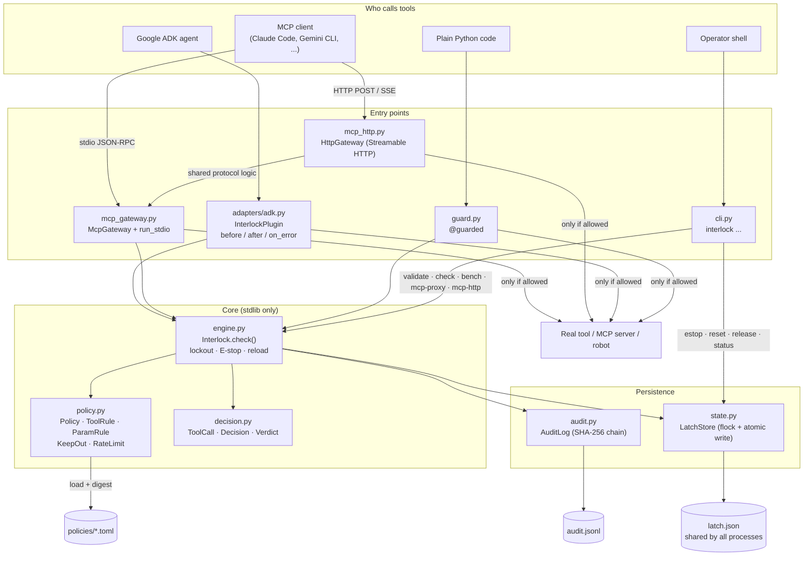
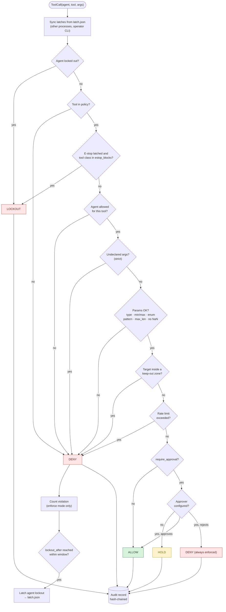
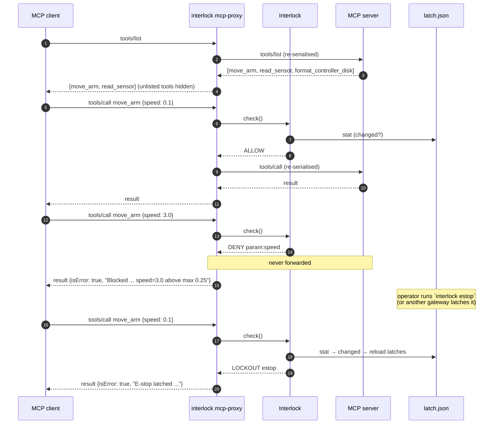
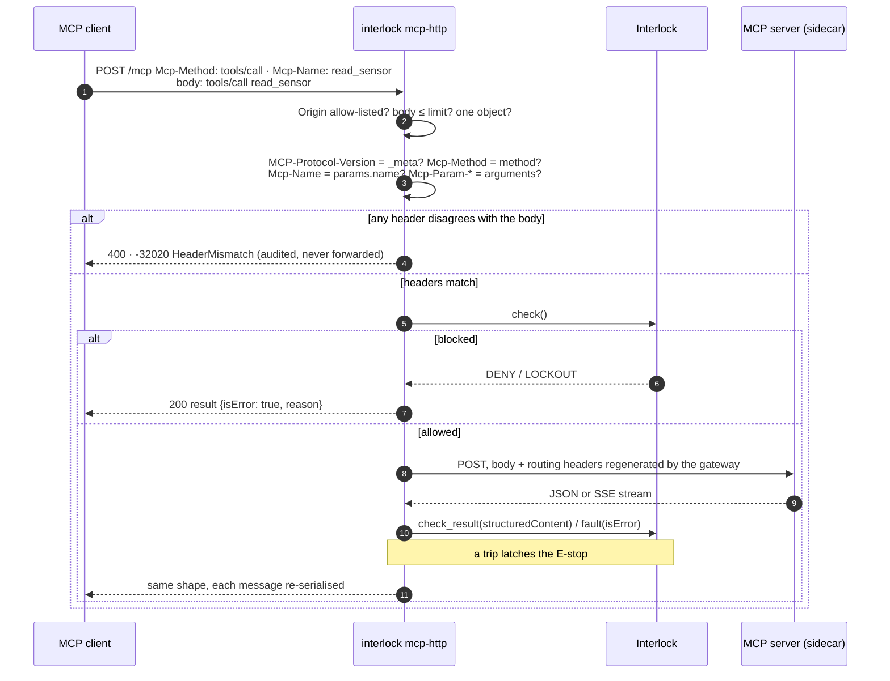

# Architecture

Four views of the codebase (v0.3.0). GitHub renders these diagrams inline.

## 1. Modules and how they connect

Entry points on top. Every path into a tool goes through `Interlock.check()`.

## 2. What `check()` does, in order

The first check that fails decides the verdict. Anything not explicitly
allowed is denied.

In **observe** mode, DENY and HOLD are logged but not enforced.
LOCKOUT (lockouts and the E-stop) and an operator's rejection are always
enforced.

## 3. MCP gateway: one session

## 4. Streamable HTTP gateway: one POST (spec 2026-07-28)

Each request is self-contained. Headers mirror body fields so routers can
act without parsing JSON. The gateway parses the body, so it must prove the
two agree before the policy check means anything.

## File map

| Path | Role |
|---|---|
| `src/agent_interlock/engine.py` | `Interlock`: check pipeline, violation counting, lockout, E-stop, reload |
| `src/agent_interlock/policy.py` | TOML → compiled, validated `Policy` (fails at load, never at call time) |
| `src/agent_interlock/decision.py` | `ToolCall`, `Decision`, `Verdict` value types |
| `src/agent_interlock/audit.py` | Hash-chained JSONL audit log, `verify()` |
| `src/agent_interlock/state.py` | `LatchStore`: persistent, cross-process lockouts and E-stop |
| `src/agent_interlock/mcp_gateway.py` | MCP protocol logic + stdio proxy: gates `tools/call`, filters `tools/list`, trips on results |
| `src/agent_interlock/mcp_http.py` | Streamable HTTP reverse proxy: header/body validation, JSON + SSE relay |
| `src/agent_interlock/adapters/adk.py` | Google ADK plugin and callback |
| `src/agent_interlock/guard.py` | `@guarded` decorator for any Python callable |
| `src/agent_interlock/cli.py` | `interlock` command |
| `policies/robot_cell.toml` | Example policy for a robot cell |
| `examples/` | Scripted demo, ADK agent, MCP robot server (stdio or HTTP) |
| `deploy/cloudrun/service.yaml`, `Dockerfile` | Cloud Run: gateway as ingress, MCP server as sidecar |
| `tests/` | 129 tests incl. real ADK (scripted-model end-to-end) and MCP SDK interop (stdio + HTTP) |
